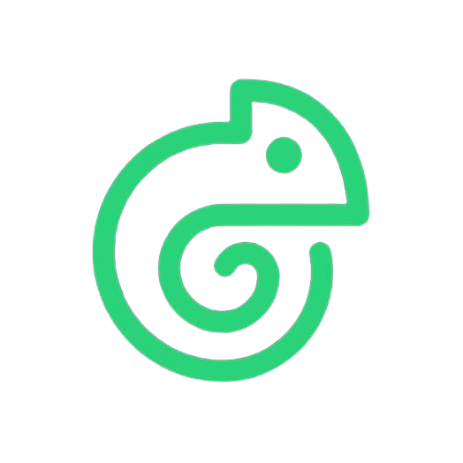

# Chame


> [English](README.md) | **中文**

<p align="center"></p>

<p align="center">
  <a href="https://github.com/cuihairu/chame/actions"></a>
  <a href="LICENSE"></a>
  <a href="https://go.dev/"></a>
  
</p>

**Chame** 是一个把区块链抽象在统一运行时之后的 **Go 游戏后端框架**。游戏侧只面对
一套 API，EVM 与 Solana 都是其后的适配器。

## 为什么做

接一条链要一套 SDK、一套密钥方案、一套事件模型。加第二条链通常意味着重写对接层。
Chame 把链收进适配器，游戏侧保持同一份契约。

## 范围（来自设计稿）

| 领域 | 内容 |
|---|---|
| Runtime | 生命周期、调度、恢复 |
| 适配器 | EVM、Solana |
| 交易模型 | 跨链统一状态机 |
| 可靠性 | 幂等键、持久化、恢复 Worker |
| 事件 | 游标式断点续传、链重组处理 |
| 安全 | 可插拔签名器、权限边界、本地开发密钥 |
| Provider | `AccountProvider`、`AssetProvider` |
| 运维 | 错误分类、日志、指标、测试、CI |

## 当前状态

**阶段一至九已落地。** 完整规格见
[`docs/design/chame-spec.md`](docs/design/chame-spec.md)——共 24 章，覆盖架构、
适配器、交易状态机、幂等、事件处理、签名、错误模型、可观测性、测试、CI、
分期实施与完成定义。

已交付：Runtime 生命周期容器（模块注册、依赖图校验、优雅关闭）、分层配置
系统、链无关身份模型（`NetworkID`、`Address`、`Amount`、`AssetID`）、交易
公共模型与状态机（`capability/transaction`——unknown/reorged 显式表达不确定
性，终态冻结）、只读 EVM 适配器（`adapters/evm`——多网络实例、Endpoint
切换、逐端点 Chain ID 校验、健康检查、原生与 ERC-20 余额、`eth_call`、日志
读取）、只读 Solana 适配器（`adapters/solana`——独立集群实例、逐端点
Genesis Hash 校验、账户/原生/SPL Token 查询、交易与签名历史、Commitment
配置、显式 unsupported-capability 错误）、`core/errors` 全量错误分类，以及
持久化层（§10——Repository 契约：幂等唯一性、条件状态更新、对账租约；测试
用内存实现；PostgreSQL 实现过同一 conformance 套件；幂等解析服务；基于租约
多实例去重的恢复 Worker），以及链上事件处理（§11——共享事件模型与链族感知
位置身份、事件 Repository 含游标持久化与重组失效、至少一次投递 Dispatcher
含最终性门控、重试转 poisoned 与重组回滚，外加后台任务与事件处理器的
Registry 注册位），以及签名与密钥安全（§12——`capability/signer` 契约：
每次请求显式目标网络与账户、Allow-list 授权、载荷摘要审计条目、脱敏的
Secret 类型；确定性测试签名器；拒绝生产环境的 EVM 与 Solana 本地开发
签名器；`examples/signing` 示例），以及账户与资产（§13——
`capability/account` 与 `capability/asset` 契约：带所有者类别的账户记录、
由签名器自身 allow-list 回答的 Signer 管理归属、按各资产精度表达的原生与
Token 余额、资产元数据与链特有信息明细，并接入两个适配器，使每个 EVM 与
Solana 网络都作为模块能力提供），以及可观测性（§14–§15——由错误类别与
操作语义（而非错误字符串）决定的重试策略；§15.1 日志字段契约与脱敏
Handler（脱敏密文字段名与 URL 凭据）；指标契约、封闭的标签白名单、框架
指标名清单与进程内收集器；以及健康检查作用域——可选的 Solana 模块不可用
不会让完全不使用 Solana 的服务失去就绪）。
架构决策汇总在
[`docs/design/decisions.md`](docs/design/decisions.md)，详细 ADR 在
[`docs/decisions/`](docs/decisions/)。分期实施见 [`todo.md`](todo.md)——
下一步：测试体系与 CI。

## 开发

需要 Go 1.26+。

```sh
make ci        # gofmt 检查 + vet + 构建 + 测试
make test-race
make lint      # golangci-lint
```

CI 在 Go 1.26.x 与 1.27.x 上执行同样检查，另含 golangci-lint 与依赖漏洞扫描。

## 许可证

[Apache-2.0](LICENSE)。
